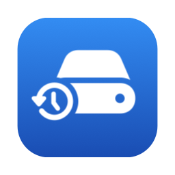
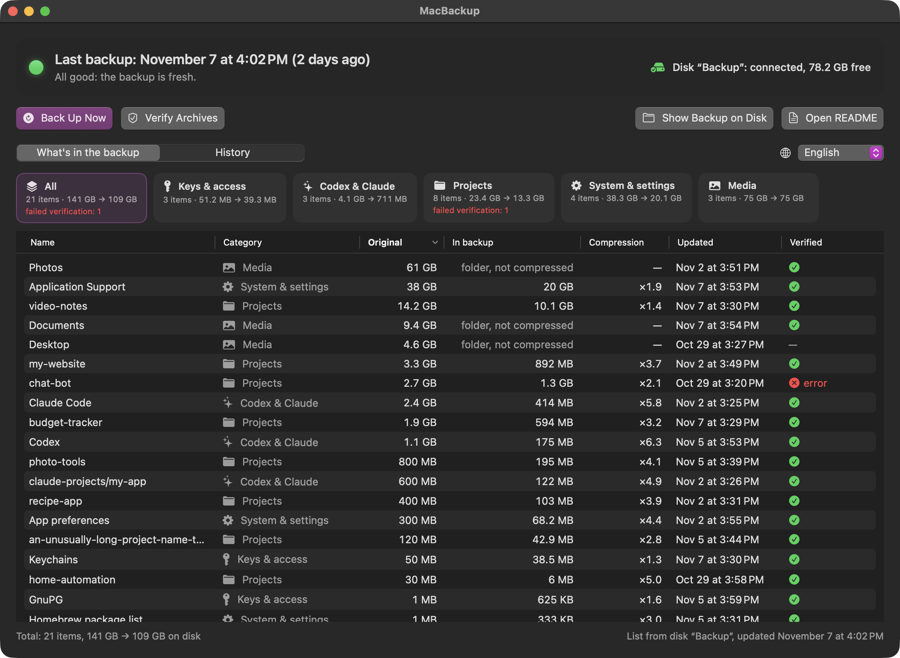
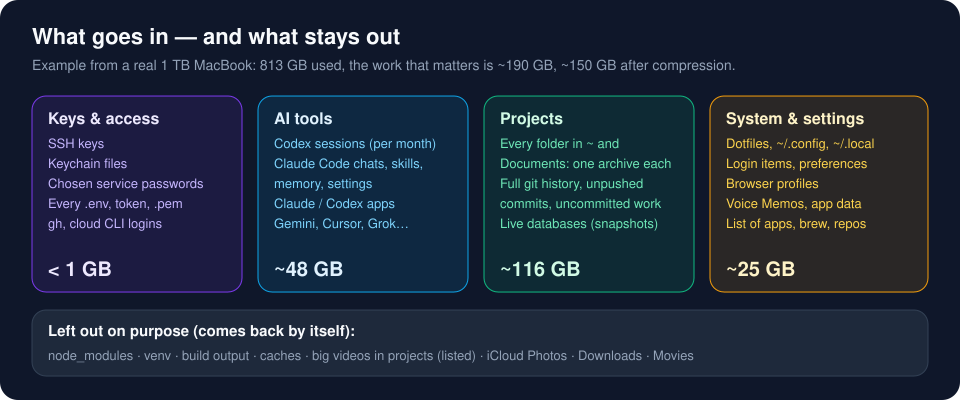
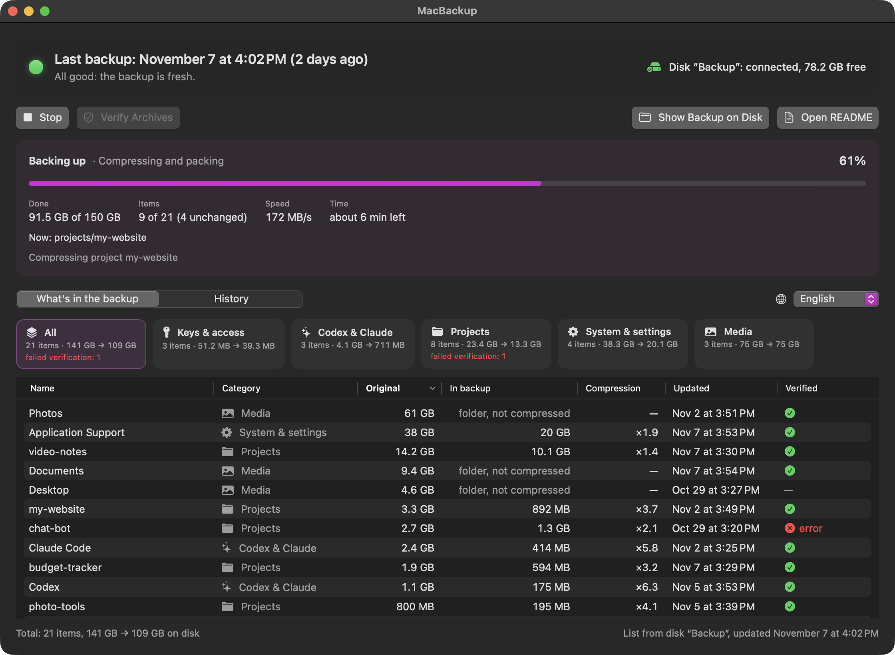
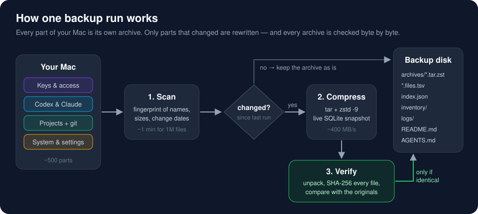

<p align="center">
  
</p>

<h1 align="center">MacBackup</h1>

<p align="center">
  <b>A disaster-recovery backup for people who build things on their Mac.</b><br>
  Keys, server access, Codex &amp; Claude Code history, every project with its git history —<br>
  compressed, verified byte by byte, and restorable on any Mac with one built-in command.
</p>

<p align="center">
  <a href="../../releases/latest">Download</a> ·
  <a href="#quick-start">Quick start</a> ·
  <a href="#restore-on-a-new-mac">Restore</a> ·
  <a href="#macbackup-vs-time-machine">vs Time Machine</a> ·
  <a href="#how-it-works">How it works</a>
</p>

<p align="center">
  
</p>

---

## Why

If your laptop dies today, what do you actually lose?

Not your photos — they are in iCloud. Not your apps — they reinstall. What hurts is the stuff that
**only exists on this one machine**:

- the SSH key that gets you into your production server, and the root password you saved in Keychain;
- `.env` files with API keys for twenty projects;
- months of **Codex and Claude Code** sessions, skills, memory and settings;
- commits you never pushed, branches with no upstream, folders that were never on GitHub at all;
- the little scripts, login items and dotfiles that make your Mac *yours*.

MacBackup copies exactly that to an external drive — about **150 GB instead of a full 800 GB disk image** —
and keeps it fresh automatically.

<p align="center"></p>

## Features

- **Smart scope.** Every folder in your home and in `~/Documents` becomes its own archive. AI tools
  (Codex, Claude Code, Claude app, Gemini/Antigravity, Cursor, Grok) are detected and split sensibly —
  Codex sessions per month, Claude Code chats per project.
- **Leaves out what comes back by itself:** `node_modules`, virtualenvs, build output, caches, large videos
  inside projects (listed in `inventory/skipped-big-media.tsv` so you know exactly what was skipped).
- **Incremental.** A fingerprint of names, sizes and change dates decides what changed. The first run
  takes about an hour; a weekly run usually takes a few minutes.
- **Verified, not hoped.** After writing, every archive is decompressed and **every file is SHA-256-checked**
  against the manifest, then up to 25 files per part are compared with the originals on your Mac.
- **Live databases done right.** SQLite files (bots, apps, Codex history) are copied with SQLite's backup
  API, so you get a consistent snapshot even while the app is writing.
- **Secrets collected in one place.** All `.env`, `.pem`, tokens and key folders from every project are also
  gathered into `keys/secret-files`; optionally chosen Keychain passwords are exported too.
- **Restore needs nothing installed.** Archives are `tar` + `zstd`. macOS's built-in `tar` reads them with
  the self-contained `zstd` that MacBackup keeps on the drive (`tools/zstd`):
  `PATH="<drive>/MacBackup/tools:$PATH" tar -xf part.tar.zst -C ~`.
- **Calm about real life.** Unplug the drive in the middle of a backup — nothing breaks. It pauses, cleans up
  the half-written file next time and continues where it stopped. No alarm notifications; a reminder comes
  only if a backup is overdue for days.
- **Native Mac app** with a menu-bar icon: progress, speed, time left, what's inside, run history and logs.
  English and Russian.
- **Agent-friendly.** The drive carries a `README.md` for people and an `AGENTS.md` for AI agents, plus a
  machine-readable `index.json`, per-file manifests and full logs — point Claude Code or Codex at the drive
  and ask it to restore your Mac.

<p align="center"></p>

## MacBackup vs Time Machine

They solve different problems, and they work best **together**.

|  | Time Machine | MacBackup |
|---|---|---|
| What it copies | The whole disk, apps and system included | The work that exists only on this Mac |
| Size on the drive | ≈ everything you use (often 500 GB – 1 TB) + history | ≈ 15–20% of it (e.g. 150 GB of 813 GB) |
| Shares a drive with your films | Wants its own volume and space for history | A folder next to anything else |
| Restore | Whole Mac via Migration Assistant | Any single project, or everything, with `tar` — on any Mac |
| Needs | Same macOS family, Migration Assistant | Nothing: built-in `tar` + `zstd` kept on the drive |
| Proof the copy is good | Trust | Every file re-hashed after every run |
| Understands dev work | No — copies `node_modules` and caches too; a live database may be caught mid-write | Skips rebuildable junk, snapshots live DBs, gathers every secret, reports unpushed git work |
| Readable without the app | Only through Time Machine | Plain archives + manifests + `README.md` / `AGENTS.md` |
| History of old versions | Yes (hourly/daily/weekly) | Latest version of each part |

**Recommendation:** use Time Machine on a dedicated drive if you can, for the full-system safety net and file
history. Use MacBackup for the irreplaceable work — it fits on the drive you already carry, and it's the one
you'll actually be able to restore from on a borrowed Mac in an hour.

## How it works

<p align="center"></p>

<details>
<summary><b>Why zstd -9 (measured)</b></summary>

700 MB samples on an M1 Max:

| codec | ratio on code / chats | speed |
|---|---|---|
| zstd -3 | ×1.49 | 1460 MB/s |
| **zstd -9 --long=27** | **×1.59** | **360–440 MB/s** |
| zstd -15 --long=27 | ×1.61 | 65–130 MB/s |
| zstd -19 --long=27 | ×1.64 | 13–15 MB/s |
| xz -6 | ×1.56 | 22 MB/s |
| brotli -9 | ×1.58 | 3–11 MB/s |

Level 9 with a long window is within 1–3% of the strongest settings at 15–30× the speed.
</details>

## Quick start

1. **Install the dependency** (once): `brew install zstd` — Python 3 ships with macOS / Xcode tools.
2. **Download** `MacBackup.zip` from [Releases](../../releases/latest), unzip, move `MacBackup.app` to
   `/Applications` or `~/Applications`. The app is ad-hoc signed: the first time, right-click → **Open**.
3. Open **Settings** (⌘,): choose your backup disk, language, and how often to back up (default: every 7 days).
4. Give MacBackup access to your files: **System Settings → Privacy & Security → Full Disk Access → MacBackup**.
5. Click **Back up now**. The first run takes a while; after that it's minutes.

To back up automatically, install the scheduler (runs hourly and whenever a disk is connected; it only does
work when a backup is due):

```bash
./scripts/install-scheduler.sh
```

### Configuration

`~/Library/Application Support/MacBackup/config.json` — the app edits the common keys; the rest is for power users.
See [`config.example.json`](config.example.json):

| key | meaning |
|---|---|
| `disk_volume`, `dest_folder` | where the backup lives, e.g. `/Volumes/Backup` + `MacBackup` |
| `due_days`, `reminder_grace_days` | back up every N days; remind only after N more days without the disk |
| `split_dirs` | big folders archived per child (e.g. `Documents/Codex`) |
| `system_folders` | home folders that are "system" rather than projects (e.g. `Backups`) |
| `home_skip`, `documents_skip`, `exclude_paths` | things to leave out |
| `mirror_folders` | folders copied as-is, uncompressed (e.g. course videos you also want to watch from the drive) |
| `secret_extra_paths` | extra key files/folders to gather into `keys/secret-files` |
| `keychain_export_regex` | export these Keychain service passwords **with values** (empty = off). Only use on an encrypted drive. |
| `video_skip_mb` | skip videos larger than this inside projects (default 20) |

### Command line

```bash
E="python3 MacBackup.app/Contents/Resources/engine/macbackup.py"
$E plan            # what would be backed up, sizes, what changed — writes nothing
$E run             # back up now
$E verify --all    # re-check every archive on the drive
$E auto            # what the scheduler runs
$E cancel          # stop gracefully
```

## Restore on a new Mac

Every archive restores into your home folder with the tar that comes with macOS. It needs a `zstd`
program for `.tar.zst`, and a fresh Mac has none, so MacBackup keeps a self-contained one (universal,
no dependencies) on the drive in `tools/`:

```bash
cd /Volumes/<YourDisk>/MacBackup
export PATH="$PWD/tools:$PATH"                                   # use the zstd from the drive
for a in archives/keys/*.tar.zst; do tar -xf "$a" -C ~; done    # keys first
chmod 700 ~/.ssh && chmod 600 ~/.ssh/*
find archives -name '*.tar.zst' -print0 | xargs -0 -n1 tar -C ~ -xf  # or everything
```

- Need one file? `grep -l "name" archives/*/*.files.tsv archives/*/*/*.files.tsv` tells you which archive has it.
- Apps: `inventory/apps.tsv` and `inventory/brew.txt` list what to reinstall.
- The drive's own [`README.md`](engine/DISK-README.md) walks through it step by step, and
  [`AGENTS.md`](engine/DISK-AGENTS.md) lets an AI agent do it for you.

## Safety

- **Encrypt the backup drive** (Finder → right-click the disk → Encrypt, or format as APFS (Encrypted)).
  Archives themselves are not password-protected, by design: you should never be locked out of your own
  backup by a forgotten second password. The drive's encryption is the lock.
- Keychain export is **off by default**. When enabled, values go only into the archive on the drive — never into
  logs, the app, or the terminal.
- Nothing is uploaded anywhere. No network access at all.

## Project layout

```
engine/macbackup.py      the whole engine (Python 3.9+, stdlib only, + zstd CLI)
engine/DISK-README.md    copied to the drive as README.md (for people)
engine/DISK-AGENTS.md    copied to the drive as AGENTS.md (for AI agents)
app/                     SwiftUI app (Swift Package) — build with app/build.sh
scripts/                 scheduler install/uninstall, build-portable-zstd.sh (zstd for the drive)
docs/images/             pictures for this README
```

Data on your Mac: `~/Library/Application Support/MacBackup/` (`config.json`, `state/`, `logs/`).
Logs are JSON lines (`logs/runs.jsonl`) plus a human-readable log per run, mirrored to the drive.

## Build from source

```bash
git clone https://github.com/Lemelson/MacBackup && cd MacBackup
./app/build.sh            # builds and installs ~/Applications/MacBackup.app (bundles the engine)
```

Requires Xcode command line tools (Swift 5.10+), macOS 14+.

## License

MIT — see [LICENSE](LICENSE).
